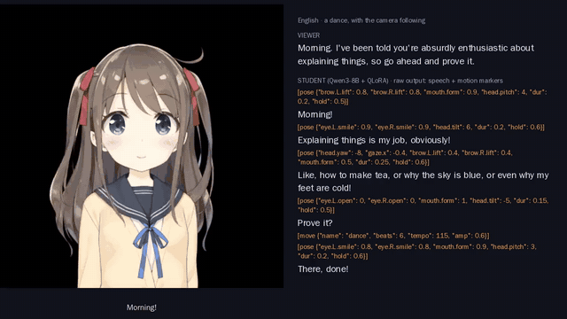
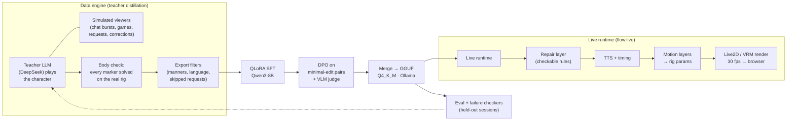

# Tsukuyomi

**A language model that talks *and* moves its own avatar.** Tsukuyomi is a
streaming character built on a fine-tuned Qwen3-8B. In one token stream it
writes what it says and small motion markers (`[pose …]`, `[move …]`,
`[frame …]`). A runtime solves those markers on a Live2D or VRM rig, times
them to the synthesized voice, and layers idle motion, gaze and
micro-expressions on top. It runs live at 30 fps on one consumer GPU, in
English, Japanese and Chinese.



▶ **[64-second demo video](docs/media/demo.mp4).** Four replies from the
student model's held-out eval, unedited, rendered on Live2D's free sample
model Hiyori:
- a dance, with the camera following the move;
- looking left then right, on the character's own sides;
- a both-hands wave;
- an empathetic face in Japanese.

The right-hand panel shows the raw model output, speech and motion markers
together. This render was made offline without TTS, so subtitles stand in
for the voice.

---

## Why this is an embodiment problem

A chat model has no body. Tsukuyomi treats the avatar as an action space the
model must learn to use:

- **Grounded action vocabulary.** Every rig is probed once. That gives each
  parameter's range and its effect on the drawn mesh, a reach map for each
  hand, and which arm drawings exist. The model gets a body description in
  shared terms (`head.yaw`, `hand.R.y @shoulder.y`, `gaze.x`), and a solver
  maps its targets back to the rig's own parameters. Targets out of reach
  are clipped and logged.
- **Embodiment-aware behaviour.**
  - A per-body motion budget keeps limited Live2D rigs face-first, while
    capable bodies may move their hands.
  - The camera switches between bust and full framing, and follows
    whole-body moves.
  - "Look to your right" means the character's own right. A mentioned
    object ("I put it at your right foot") gets a glance without being
    asked.
- **Timing.** Markers act on the word they precede; the time comes from the
  TTS word boundaries. Head carry, eased pose transitions, an expression
  baseline and voice-driven micro-expressions keep the face alive between
  the model's beats.

## How it works



1. **Data.** A teacher LLM writes whole stream sessions against a body-aware
   prompt, opposite simulated viewers. Every marker is solved on the target
   rig before it is kept. The latest round, r3, has 16,000 turns across 6
   avatars and 3 languages, and cost $6.29 to generate.
2. **Student.** Qwen3-8B with 4-bit QLoRA (r 32, all projections), trained
   on one RTX 3090 Ti. It is served as a 4-bit GGUF (~5 GB) through Ollama.
3. **Preference tuning.** DPO uses pairs that differ in exactly one checkable
   thing: a flipped look side, a missing wave, a copied pose sequence, a
   repeated correction, a glance at a mentioned object. A vision-language
   judge (Qwen3-VL-32B) scores rendered keyframes. The DPO trainer is native
   (no TRL), with precomputed reference log-probs.
4. **Live.**
   - **Streaming:** sentence-level streaming to TTS, so the first text
     arrives in 0.3–0.8 s on a 30-turn session.
   - **Robustness:** a first-token and stall watchdog, chat batching, and
     context-budget trimming that keeps Ollama's prompt cache.
   - **Memory:** short memory notes (game state, corrections, facts about
     viewers), updated after the turn by a separate model.
   - **Reminders:** a small rule graph injects only the reminders a message
     triggers.
   - **Repair:** a repair layer fixes checkable marker mistakes before they
     play, and logs each fix as a training pair.

## Results

All figures come from held-out sessions of the r3 data, scored by the
project's failure checkers (`scripts/checks.py`).

**Student vs. its predecessor.**

| | q8r2 | q8r3 |
|---|---|---|
| Stock opening reused | 26% | 1% |
| Wrong reply language | 4% | 0% |
| Dance without full-body framing | 91% | 12% |
| Hand request not carried out | 21% | 16% (the teacher misses 22%) |

**Rule reminders at inference, the same q8r3 weights, 820 turns.**

| Check | Full prompt | + reminders |
|---|---|---|
| Look request answered on the wrong side | 9% | 4% |
| Full framing for a wave, which should stay in bust | 32% | 12% |
| Quiet-chat turn says "chat is quiet" | 3% | 0% |
| Copied an earlier reply's poses | 1% | 0% |

The samples are small (54 look requests), so each line alone could be
chance; all four went the same way. The cost was 1.6% broken markers,
traced to a rule shown to a body that cannot follow it, and fixed by making
rules capability-aware.

**Live.**
- First text arrives in 0.3–0.8 s and first audio in about 3 s, across
  30-turn sessions.
- Rendering runs at 30 fps.
- Pose targets are 98.8% within the rig's reach.

**Next data round (r4, piloted).**
- The share of replies with something concrete in them (an opinion, a
  detail, a callback) rose from 40% to 79%.
- Interjection openings fell from 37% to 17%.
- A per-turn length plan gives replies a real spread.

## Quick start (no GPU, no model)

Render a reply on a free Live2D sample, here a recorded student reply:

```bash
pip install -r requirements.txt          # Python 3.11+, plus ffmpeg on PATH
# Get Live2D's sample models (Free Material License) from
# https://github.com/Live2D/CubismWebSamples (Samples/Resources/Hiyori)
echo '[pose {"head.yaw": -18, "gaze.x": -0.7, "dur": 0.4, "hold": 2}] Over here? [pose {"eye.L.smile": 0.9, "eye.R.smile": 0.9, "head.tilt": 6}] Found it!' > reply.txt
xvfb-run -a python -m flow.director --model-json path/to/Hiyori/Hiyori.model3.json \
  --rig rigs/Hiyori.npz --mode body --backend file --reply-file reply.txt \
  --tts edge --render --out out/hello
```

Live, with a student model in Ollama:

```bash
python -m flow.live --mode body --model-json path/to/Mao/Mao.model3.json --rig rigs/Mao.npz \
  --backend ollama --model <your-student> --body-prompt beats2 --tts auto --port 8765 \
  --ollama-ctx 16384 --history-turns 12 --memory summary --reminders auto --repair auto
# open http://localhost:8765 and chat
```

Training, evaluation, DPO and data generation each have a script and a
documented recipe in [`docs/embodiment.md`](docs/embodiment.md):
- `scripts/datagen.sh`;
- `scripts/train_sft.py`;
- `scripts/eval_sft.sh`;
- `scripts/dpo_pairs.py`;
- `scripts/train_dpo.py`;
- `scripts/checks.py`.

## Repository

| Path | What |
|---|---|
| `flow/director.py`, `flow/live.py` | Offline director and the live loop (backends, streaming, watchdog, chat batching) |
| `flow/body.py`, `flow/pose.py`, `flow/framing.py`, `flow/moves.py` | Body model, pose solver, prompts, motion budget, camera, rhythmic moves |
| `flow/runtime.py`, `flow/micro.py`, `flow/squint.py`, `flow/vrm*.py` | Live2D / VRM rendering and the motion layers |
| `flow/dataset.py`, `flow/dataexport.py`, `flow/datanotes.py` | Data engine: teacher sessions, simulated viewers, export filters |
| `flow/train/` | QLoRA SFT, native DPO, eval harness, VRAM planning |
| `flow/checks.py`, `flow/style.py`, `flow/judge.py`, `flow/dpo.py` | Failure checkers, style metrics, VLM judge, preference pairs |
| `flow/memory.py`, `flow/rules.py`, `flow/repair.py` | Live memory notes, rule graph and reminders, repair layer |
| `l2dprobe/` | Probing a Live2D rig into a body description |
| `tests/` | Over 1,100 unit and integration tests (fake backends, no network) |
| `docs/embodiment.md` | The full design notes and run recipes |
| `docs/research.md` | Literature notes: motion control, long prompts, memory |

## Credits and rights

- Hiyori, Mao and Natori are Live2D Inc. sample models under the
  [Live2D Free Material License](https://www.live2d.com/eula/live2d-free-material-license-agreement_en.html).
  The model files are not included in this repository; download them from
  CubismWebSamples.
- The two VRM samples in `assets/vrm/` are from pixiv's three-vrm, and are
  redistributable under their own VRM licence metadata (see
  `assets/vrm/README.md`).
- `rigs/` holds measured parameter descriptions only, not art or model
  files. Characters owned by third parties are used for internal testing
  only, and never for streaming.
- No trained weights or generated datasets are included.

Code: MIT ([LICENSE](LICENSE)).
